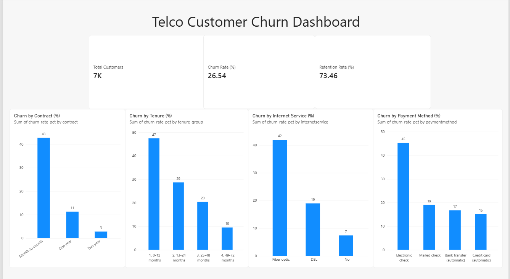

# Telco Customer Churn & Retention Analysis

SQL (PostgreSQL), pandas and Power BI analysis of customer churn for a telecom company (7,043 customers).

## Business questions

- What percentage of customers churn?
- Which contracts and services have the highest churn?
- Does longer tenure reduce churn?
- Is higher pricing associated with churn?
- Which customer groups are most likely to leave?

## Data

IBM Telco Customer Churn sample dataset, shared on Kaggle by BlastChar. 7,043 customers, 21 columns (demographics, services, contract, charges, churn status). The data is not included in this repo (download it from Kaggle). The dataset has no stated currency and no date column, so there is no churn-over-time view; churn by tenure is used instead.

## Tools

PostgreSQL, SQL, Python (pandas, matplotlib, SQLAlchemy), Jupyter, Power BI

## Data checks and cleaning

- 7,043 rows, no duplicate customer IDs
- TotalCharges had 11 blank values (new customers with tenure 0); converted to numeric and left as NULL
- Column names lowercased on load; churn converted to a 0/1 flag for analysis in pandas
- SQL and pandas results were cross-checked (both give a 26.54% churn rate)

## Key findings

1. Overall churn is 26.54% (1,869 of 7,043 customers); retention is 73.46%.
2. Contract type is the strongest signal: month-to-month churn is 42.71%, against 11.27% for one-year and 2.83% for two-year contracts. Month-to-month customers are 55% of the base but about 89% of all churners.
3. Churn falls with tenure: 47.44% in the first 12 months, 9.51% after 49 months.
4. Contract still matters within every tenure group. First-year month-to-month customers churn at 51.4% (1,994 customers).
5. Fiber optic customers churn at 41.89%, against 18.96% for DSL and 7.40% for customers without internet service.
6. Electronic check users churn at 45.29%, against 15% to 19% for the other payment methods.
7. Higher monthly charges go with higher churn (10.86% under 35, 37.95% for 70 to 90), but the link is weak (correlation 0.19). Tenure has the strongest numeric correlation with churn (-0.35).

## Limitations

- These are associations, not proof of cause. Factors overlap (for example, fiber optic plans cost more, so price and service type are tangled together).
- Two-year contracts show 0% churn in the first 24 months, but this rests on only 158 customers, so it should be read as "very low" and not "zero".

## Recommendations

1. Build an onboarding and early-retention program for the first 12 months.
2. Offer incentives to move month-to-month customers to one-year or two-year contracts.
3. Investigate fiber optic service quality and pricing, since it has the highest churn.
4. Encourage automatic payment methods over electronic check.

## Repository

- `load_data.py`: loads the CSV into PostgreSQL
- `sql/`: data checks and churn analysis queries
- `notebooks/telco_churn_eda.ipynb`: pandas exploration, charts and correlations
- `dashboard/`: Power BI file, exported CSVs and screenshot
